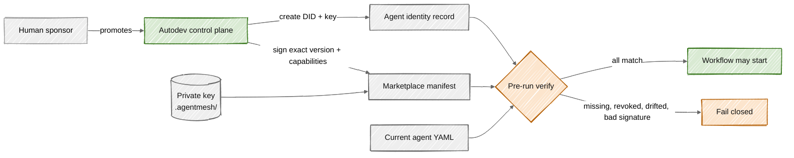

# Agent mesh and identity

**Status:** Current identity design, with explicit limits on distributed mesh behavior.

## What "agent mesh" means here

Autodev currently uses AgentMesh-compatible primitives to give a promoted agent a stable DID, an Ed25519 key, and a signed marketplace manifest. The control plane verifies that identity before execution and continuation.

This is an **identity plane**, not yet a distributed execution mesh. Agent routing, workflow stages, sandboxes, and handoffs are owned by Autodev's deterministic workflow controller. Standalone AgentMesh registry, relay, proxy, peer handshake, and delegated execution services are not in the current topology.

## Components inside the boundary

| Component              | Current responsibility                                                        | Source                                                                                                     |
| ---------------------- | ----------------------------------------------------------------------------- | ---------------------------------------------------------------------------------------------------------- |
| `AgentIdentityService` | Enroll, refresh, verify, revoke, and list identities                          | [service.py](../../apps/api/app/agent_identity/service.py)                                                 |
| Agent identity record  | Store DID, public key, sponsor, organization, status, and signed capabilities | [identity models](../../apps/api/app/models/identity/)                                                     |
| Private key store      | Keep an organization-and-agent-scoped PEM key with mode `0600`                | [service.py](../../apps/api/app/agent_identity/service.py)                                                 |
| Marketplace entry      | Store the signed plugin manifest and its agent DID                            | [service.py](../../apps/api/app/agent_identity/service.py)                                                 |
| Workflow/session gates | Verify identity before a task run or durable continuation                     | [workflow.py](../../apps/api/app/workflow.py), [session_service.py](../../apps/api/app/session_service.py) |

## Enrollment lifecycle

1. A human principal promotes or enrolls an agent in one organization.
2. `AgentIdentity.create` creates a DID and Ed25519 key pair from the agent name, sponsor, organization, description, and declared capabilities.
3. The private key is written under `WORKBENCH_AGENT_IDENTITY_DIR`, which defaults to `.agentmesh`.
4. The database stores the public identity record. Human sponsor identity remains separate from agent identity.
5. Autodev signs a marketplace manifest containing the agent ID, version, author DID, and capabilities.
6. Autodev verifies the new signature before persisting the marketplace entry.

Re-enrollment refreshes the manifest and capability list for an existing record. Revocation changes the identity status; it does not silently mint a replacement identity.

## Pre-execution verification

Verification is deliberately narrower than general trust discovery. It checks:

- an identity exists for the selected agent and organization;
- the identity status is `active`;
- current declared capabilities equal the recorded signed capabilities;
- a marketplace entry exists and points to the same DID;
- the stored manifest validates with the recorded Ed25519 public key.

Any mismatch blocks execution. Prompt text, model choice, human role, and sandbox state cannot compensate for a failed identity check.

## What the signature proves

The signature proves that the locally held key signed the stored manifest and that the manifest is bound to the recorded DID, version, and capability declaration. It supports local drift detection and auditable promotion.

It does **not** currently prove:

- public marketplace reputation or global PKI trust;
- remote agent availability or liveness;
- the safety of an agent's prompt or model output;
- permission to perform a specific tool action;
- an A2A delegation chain.

Tool permission still passes through harness, governance, runtime supervision, approval, and sandbox boundaries. The accepted identity and tenancy invariants are recorded in [ADR 0009](../adr/0009-identity-auth-tenancy-and-publication.md).

## Relationship to multi-agent workflows

An executable workflow may select several local agent DIDs. The workflow controller verifies and runs each responsible role, but agents do not discover or invoke one another. They communicate through named durable artifacts selected by the workflow contract. This keeps identity verification independent from orchestration.

## Operational risks

| Risk                               | Current control                                   | Remaining concern                                                                      |
| ---------------------------------- | ------------------------------------------------- | -------------------------------------------------------------------------------------- |
| Agent YAML changes after promotion | Capability equality and promotion drift checks    | Not all declaration meaning is cryptographically captured by capability equality alone |
| Private key disclosure             | Restricted local file mode and no prompt exposure | File-backed keys are deployment-scoped; managed signing would be stronger              |
| Cross-tenant identity confusion    | Organization-scoped records and lookups           | Shared registries still limit hostile-tenant claims                                    |
| Revoked agent runs                 | Active-status verification at execution           | Long-running revocation propagation needs explicit operational testing                 |

## Design direction

Keep the identity service as the trust anchor even if remote agents are introduced. Remote discovery or A2A transport should consume verified identity and issue bounded delegation, not replace local governance. The proposed protocol boundary is described in [MCP and A2A boundaries](mcp-and-a2a.md).
