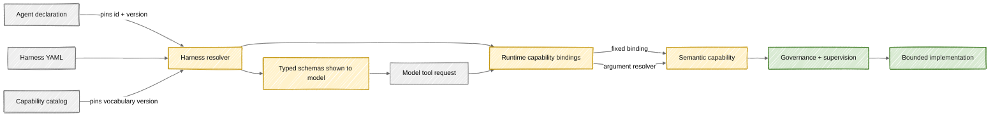

# Harness contracts

**Status:** Current contract and versioning model.

## What a harness is

A harness is the versioned boundary between a model-visible tool and an Autodev semantic capability. It answers four questions:

1. Which tools can this agent see?
2. What argument shape can the model submit?
3. Which capability does each request represent?
4. Which capability-catalog version defines that vocabulary?

The current workspace harness is [harnesses/workspace.yaml](../../harnesses/workspace.yaml). Agents pin it by exact ID and version.

## Current contents

`workspace` version `1.0.0` defines six tools:

| Tool          | Binding               | Implementation shape                                |
| ------------- | --------------------- | --------------------------------------------------- |
| `list_files`  | `repository.read`     | Bounded file listing with exclusions and pagination |
| `search_text` | `repository.read`     | Bounded literal repository search                   |
| `read_file`   | `repository.read`     | Path-safe, bounded UTF-8 chunk read                 |
| `write_file`  | `repository.write`    | Path-safe UTF-8 replacement                         |
| `delete_file` | `repository.write`    | Path-safe single-file deletion                      |
| `run_command` | `command-v1` resolver | Governed argument-vector command in a sandbox       |

Each tool has JSON Schema input. The harness pins capability catalog `governance` version `1.0.0`.

## What belongs in a harness

- Stable model-facing names and descriptions.
- Machine-validatable input schemas.
- Fixed capability bindings for semantically fixed tools.
- Named, versioned resolvers for argument-dependent tools.
- A precise capability-catalog reference.

## What does not belong in a harness

- Agent-specific grants or denials. Those belong in the agent declaration.
- Organization policy. That belongs in a governance policy.
- Trust-tier or anomaly decisions. Those belong to runtime supervision.
- Workflow timing and stage ownership. Those belong in workflow YAML.
- Human approval records. Those are durable controller state.
- Sandbox credentials, container IDs, or provider configuration.

Keeping these concerns separate allows the same harness to work with different agents, policies, model providers, and sandbox providers.

## Resolution and fail-closed behavior

At startup or invocation, [the harness resolver](../../apps/api/app/harness/resolver.py):

1. loads the current agent definition;
2. requires a harness reference with both `id` and `version`;
3. loads that harness from the registry;
4. rejects a version mismatch;
5. loads and version-checks the referenced capability catalog;
6. returns the resolved contract to the model projection and `ToolRuntime`.

Missing registry entries and version drift are errors. Autodev does not silently select the latest available contract because that could change an agent's tool authority without re-promotion and evaluation.

## Fixed binding versus resolver

A fixed binding is appropriate when every valid request has the same security meaning. Reading different repository paths remains `repository.read`, even though path safety and tenant isolation are still enforced later.

A resolver is required when arguments change the security meaning. A single command tool can represent a read-only Git inspection, test execution, dependency installation with temporary network access, or an unsupported action. The resolver must return one catalog capability or no capability. Returning no capability means deny.

Resolvers are security-sensitive code. They should parse structured arguments, avoid shell-string heuristics, use allow-lists, and gain tests for every recognized command family.

## Versioning rules

Create a new harness version when changing any model-visible schema, removing or renaming a tool, changing a capability binding, or changing resolver semantics in a way that can alter authority. Update the catalog version when changing capability meaning or vocabulary.

An agent should adopt the new exact versions through its declaration and then pass evaluation/promotion again. Existing durable workflow snapshots and evidence should retain the versions they ran with.

## Portability

The harness is provider-neutral. Copilot, Ollama, Foundry, and external evaluation adapters may project schemas differently, but they must preserve the same names, argument contract, and capability bindings. Provider convenience tools must not bypass the resolved harness.

MCP may expose operations with different protocol-level names, such as `workspace.read_file`, but those calls are translated into the same internal harness tool and execution queue. The external protocol is not a second authority model.
