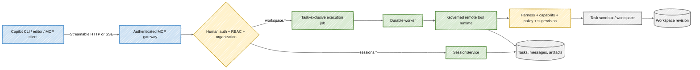
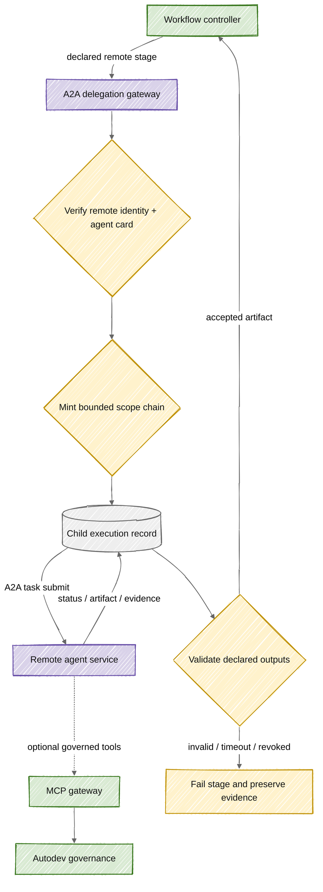

# MCP and A2A boundaries

**Status:** Current MCP design and proposed A2A integration.

## Executive answer

Autodev is **not internally dependent on MCP**. Built-in agents use the in-process governed runtime. MCP is an authenticated protocol edge that lets external clients inspect or continue durable sessions and invoke the same governed workspace operations.

A2A is not implemented. It would serve a different purpose: delegating a bounded unit of work to another agent service and tracking that work as a durable child execution. MCP should remain the tool and context interface; A2A should become a delegation interface only if remote agents are a product requirement.

## Current MCP path

The gateway is implemented in [mcp_gateway.py](../../apps/api/app/mcp_gateway.py). It exposes:

| MCP operation           | Required permission | Owning service                |
| ----------------------- | ------------------- | ----------------------------- |
| `sessions.list`         | `read`              | Durable session query         |
| `sessions.get`          | `read`              | Durable session query         |
| `sessions.continue`     | `task.operate`      | `SessionService` continuation |
| `workspace.list_files`  | `sandbox.operate`   | Governed execution job        |
| `workspace.search_text` | `sandbox.operate`   | Governed execution job        |
| `workspace.read_file`   | `sandbox.operate`   | Governed execution job        |
| `workspace.write_file`  | `sandbox.operate`   | Governed execution job        |
| `workspace.delete_file` | `sandbox.operate`   | Governed execution job        |
| `workspace.run_command` | `sandbox.operate`   | Governed execution job        |

The public paths are `/gateway/mcp` for Streamable HTTP and `/gateway/sse` for SSE. Host and origin allow-lists are transport controls; bearer/browser identity, permission checks, organization ownership, promoted-agent checks, queue exclusion, and tool governance remain application controls.

## How much Autodev leans on MCP

| Concern                                  | MCP required?        | Reason                                            |
| ---------------------------------------- | -------------------- | ------------------------------------------------- |
| Browser task creation and operation      | No                   | Uses REST and WebSocket invalidation              |
| Built-in model tool calls                | No                   | Uses `AgentRuntime` and `ToolRuntime` directly    |
| Workflow stage handoff                   | No                   | Uses named durable task artifacts                 |
| External editor/CLI session continuation | Yes, for MCP clients | MCP is the supported interoperability edge        |
| External governed workspace access       | Yes, for MCP clients | MCP translates to the existing durable tool queue |
| Agent identity and signing               | No                   | Owned by AgentMesh-compatible identity service    |

This design avoids a protocol-shaped core. Removing the MCP transport would remove an integration surface, not the task engine, workflow engine, or governance model.

## Why MCP is not A2A

MCP gives a model or client tools and context. A2A coordinates work between independently running agent services. Treating a remote agent as one very large MCP tool would hide lifecycle, cancellation, progress, identity, evidence, and authority propagation inside an opaque call.

Autodev's local workflow handoff is also not A2A. It is deterministic controller-mediated artifact transfer between locally declared roles. No agent discovers a peer, negotiates capability, or delegates authority.

## Proposed A2A placement

The proposed gateway is a new adapter boundary. It should not be embedded in model prompts or implemented as direct peer-to-peer sandbox access.

### Proposed delegation contract

A remote stage request should contain at least:

- parent task, workflow version, stage ID, and unique child execution ID;
- verified caller agent DID and target agent identity/card digest;
- allowed capabilities, organization/audience, expiry, and non-delegable flag;
- task mode and responsibility;
- declared input artifact references with hashes, not the whole task history;
- declared output names and schemas;
- cancellation deadline, retry policy, and idempotency key;
- trace context and evidence return requirements.

The response should carry status, bounded messages, output artifact references and hashes, tool/governance evidence summary, target identity, timestamps, and terminal error or cancellation reason.

### Scope-chain rules

1. Effective remote authority is the intersection of parent authority, workflow stage requirements, local deployment policy, and remote policy.
2. A remote agent cannot add capabilities or widen organization/resource scope.
3. Delegation expires and is audience-bound to one target service.
4. Re-delegation is denied by default and requires an explicit workflow contract.
5. Irreversible actions remain local controller operations with local human approval.
6. Revocation or signature failure blocks new calls and cancels work where the protocol supports cancellation.

### Durable lifecycle

Model A2A work as a parent-child execution, not a synchronous HTTP call. Child states should include `QUEUED`, `RUNNING`, `BLOCKED`, `COMPLETED`, `FAILED`, and `CANCELLED`. The controller should persist protocol task IDs, lease/heartbeat or polling state, attempts, remote identity, artifact hashes, and evidence before advancing the workflow.

Exactly-once remote side effects cannot be assumed. Submission must use an idempotency key, and acceptance must be based on a terminal child record plus validated artifacts. Retries should resume or query the same remote task before creating another.

## Adoption sequence

1. Add an `A2AProvider` interface and a fake conformance adapter; do not alter local stage execution.
2. Add read-only remote stages with no workspace write access and hash-validated text artifacts.
3. Persist child execution state and cancellation independently from parent process lifetime.
4. Add signed bounded delegation and target identity verification.
5. Optionally let remote agents call the MCP gateway for scoped tools, using the delegated identity as an additional restriction rather than a human principal replacement.
6. Consider remote write stages only after resource locking, workspace merge semantics, compensation, and approval behavior are specified.

## Decisions still required

- Which A2A specification/version and conformance suite is authoritative?
- Are remote agents organization-managed, marketplace-discovered, or explicitly allow-listed?
- Who signs delegation tokens, and where are revocation and trust state stored?
- Are artifacts pushed, pulled from signed URLs, or transferred through an evidence service?
- How are remote costs, data residency, retention, and prompt/tool evidence governed?
- Can a remote stage access a workspace snapshot, or only declared artifacts?

Until those decisions are accepted in an ADR, A2A remains a design direction. The current AgentMesh limitations are also tracked in [Agent Governance Toolkit integration status](../agent-governance-toolkit.md).
