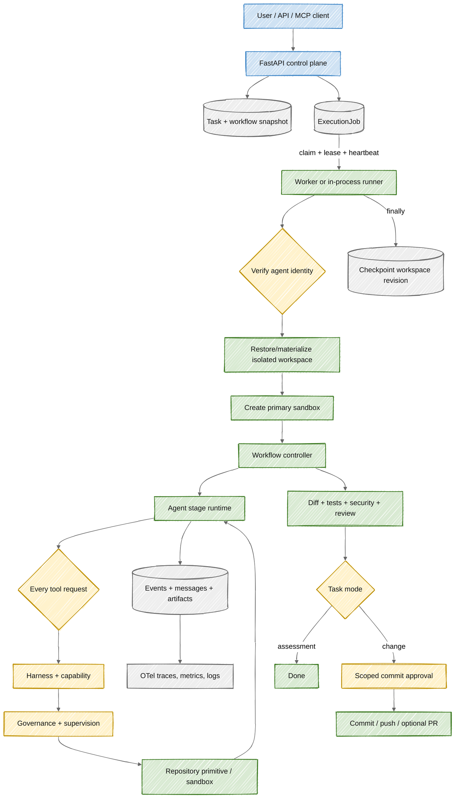

# End-to-end task execution

**Status:** Current big-picture execution model.

## Big picture

A task is the durable product object. An execution job is one leased attempt to run or operate on it. A session is the resumable user-facing history. The controller, not the model, owns state transitions from intake through approval and publication.

## 1. Task creation

The API validates the project, selected active workflow, requested task mode, selected model, and promoted agents assigned by the workflow. It stores organization and actor ownership on durable records. The exact workflow definition is saved with the task so future registry edits do not rewrite the task's contract.

`change` mode expects repository modification and enters commit approval. `assessment` mode is read-only from the product perspective and can complete without a diff or commit.

## 2. Dispatch and execution jobs

Autodev supports in-process dispatch for local development and a durable worker mode. Durable dispatch creates an [ExecutionJob](../../apps/api/app/models/tasks/execution_job.py) with operation, payload, status, attempt count, lease, and deduplication key.

Only one active job is allowed per task. An identical enqueue returns the existing job; a conflicting operation raises an execution conflict. A worker claims the oldest eligible job, increments attempts, and holds a renewable lease. PostgreSQL workers use `FOR UPDATE SKIP LOCKED` to avoid double claims.

The worker heartbeats while the operation runs. Cancellation revokes queued work immediately or causes a running worker to cancel at its next heartbeat. An expired lease may be reclaimed until `max_attempts`, currently three, is exhausted.

## 3. Identity and workspace recovery

Before useful work, the controller loads the workflow snapshot and verifies the primary agent's signed identity. Executable workflows also verify every stage agent before that stage starts.

If a durable workspace revision exists and the local workspace is absent, Autodev restores the latest digest-verified snapshot. It then materializes the project as an isolated task worktree/branch and creates the primary Docker or Azure sandbox using the agent's environment declaration.

Workspace snapshots are parent-linked revisions. Checkpoint creation compares the expected parent with the latest database revision, preventing concurrent writers from silently overwriting each other.

## 4. Runtime and workflow selection

If the captured workflow contains stages, the executable workflow engine computes sequential or DAG waves and runs each assigned role. Otherwise, the legacy path runs the selected agent once through the original SDLC controller.

`AgentRuntime` renders the promoted role instructions and starts the selected model provider session. The provider-native function loop is ReAct-like: the model requests a typed tool, receives a governed result as an observation, and decides its next explicit action. Private chain-of-thought is neither requested nor persisted.

The outer runtime adds maximum-step and timeout limits, steering messages, taskless-response rejection, model retry/recovery, provider fallback, and policy budgets.

## 5. Governed tool loop

Every tool call passes through the path in [Tool checks and governance](tool-checks-and-governance.md): schema and harness resolution, invocation budgets, capability classification, agent-policy intersection, runtime supervision, and bounded execution.

The task event stream records request, allow/deny, supervision evidence, completion, and bounded output. Agent messages and workflow-stage attribution are durable, so UI reconnects and process restarts do not depend on an in-memory conversation.

## 6. Evidence and deterministic checks

After model work, the controller collects the real Git status and diff, then writes task artifacts for changes, research, implementation, tests, security, plan, and review. Governed test tool results are summarized rather than inferred from model prose. Deterministic security scanners run against the actual workspace.

For executable workflows, named stage artifacts and the `workflow-run` artifact are additional durable evidence. Evaluation runs are separate durable contexts and do not create product tasks, approvals, or workspaces.

## 7. Completion or approval

An assessment task records completion without publication. A change task must contain changed files. The controller asks governance about `git.commit`; when approval is required, it creates a pending approval scoped to repository, branch, task, and workspace, moves the task to `AWAITING_APPROVAL`, and stops before commit.

Approval completion is a deterministic controller operation. Publication separately enforces expected worktree state, ephemeral credentials, push authorization, and optional pull-request creation. The model never receives publication credentials.

## 8. Finalization

The `finally` path checkpoints the workspace whether the run completes, fails, is cancelled, or pauses for approval. A required checkpoint failure marks the task failed. Terminal tasks clean up their sandbox; an approval-paused task retains the state needed for controlled continuation.

The execution job stores its own terminal result while the task remains the business source of truth. An approval-paused run counts as a successfully handled worker operation even though the task is not yet `DONE`.

## Durable state map

| Record            | Owns                                                                 | Survives process restart? |
| ----------------- | -------------------------------------------------------------------- | ------------------------- |
| Task              | Requested outcome, workflow/model/agent selection, lifecycle state   | Yes                       |
| ExecutionJob      | One run/tool attempt, lease, retries, cancellation, result           | Yes                       |
| Message           | User steering and explicit assistant output                          | Yes                       |
| Event             | Ordered lifecycle, tool, policy, stage, and operational evidence     | Yes                       |
| TaskArtifact      | Workflow snapshot, stage outputs, diff/test/security/review evidence | Yes                       |
| Approval          | Human decision and immutable action scope                            | Yes                       |
| WorkspaceRevision | Parent, digest, object key, and snapshot size                        | Yes                       |
| Sandbox           | Provider/container identity, network policy, workspace revision      | Yes                       |

## Failure and retry semantics

- Identity, registry, harness, policy, or supervisor errors fail closed.
- A model/provider failure can enter bounded operator-assisted recovery or configured fallback.
- A stage failure prevents later waves and preserves completed artifacts.
- A worker crash is recovered through lease expiry and retry.
- Workspace revision conflicts reject a stale checkpoint rather than overwrite it.
- Cancellation is cooperative at worker heartbeat and runtime cleanup boundaries.
- Current retries are job/task scoped, not independently stage scoped.

## Observability

Each run creates an `agent.session` trace with task, agent, mode, model, status, duration, and changed-file attributes. Worker jobs have operation-level spans and heartbeat events. Privacy-safe logs, metrics, traces, events, and evidence provide complementary views; database state remains authoritative.

## Owning code

- Main controller: [workflow.py](../../apps/api/app/workflow.py)
- Agent runtime: [agent/runtime.py](../../apps/api/app/agent/runtime.py)
- Durable queue: [execution_queue.py](../../apps/api/app/execution_queue.py)
- Worker: [worker.py](../../apps/api/app/worker.py)
- Workspace revisions: [workspace_snapshots.py](../../apps/api/app/workspace_snapshots.py)
- Session continuation: [session_service.py](../../apps/api/app/session_service.py)
- Approval/publication controller: [workflow.py](../../apps/api/app/workflow.py)
- Git/GitHub publication primitives: [repositories.py](../../apps/api/app/repositories.py)
