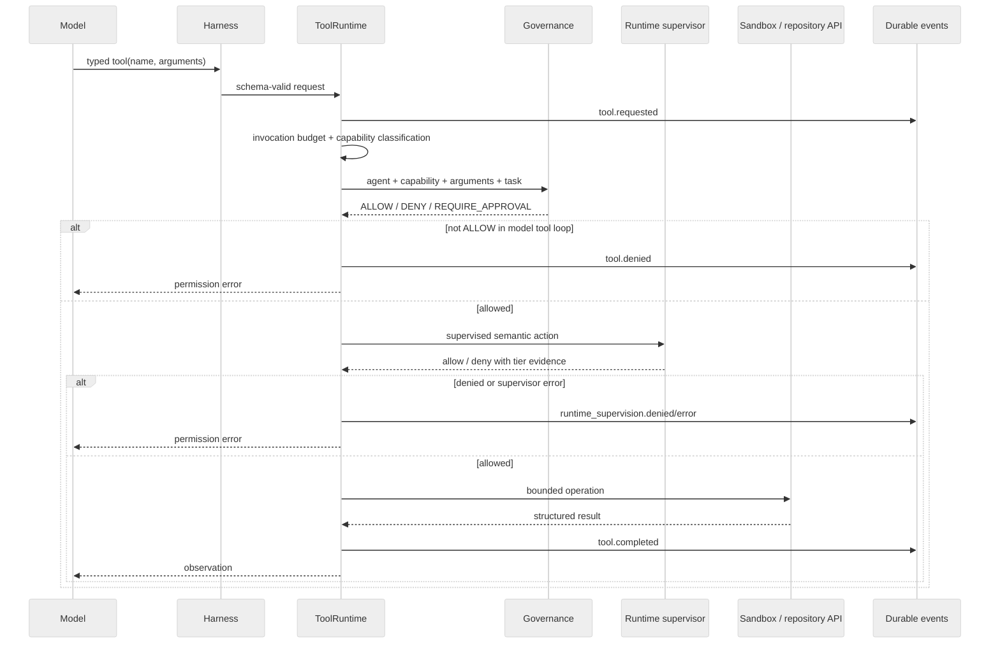

# Tool checks and governance

**Status:** Current enforcement path.

## Purpose

A model never receives ambient authority. It receives typed tools from a pinned harness, and every invocation is converted into a semantic capability before execution. Authorization is the intersection of the agent declaration, deployment policy, current runtime supervision, any scoped approval, and sandbox constraints.

## Ordered checks

| Order | Boundary                        | Question                                                                             | Failure behavior                           |
| ----- | ------------------------------- | ------------------------------------------------------------------------------------ | ------------------------------------------ |
| 1     | Framework and harness           | Is the tool present in the pinned harness, and do arguments match its schema?        | Reject the call                            |
| 2     | Invocation budgets              | Has this run exceeded tool or shell limits?                                          | Stop the call with an error                |
| 3     | Capability classification       | Which semantic action does this exact request represent?                             | Unclassified requests are denied           |
| 4     | Governance provider             | Do the agent declaration and selected policy both permit that capability?            | Deny wins; missing definitions fail closed |
| 5     | Runtime supervision             | Is the action acceptable for this execution identity, trust tier, and current state? | Denial and provider errors fail closed     |
| 6     | Scoped approval                 | Has a human approved the exact high-risk controller action when required?            | Pause or reject the controller operation   |
| 7     | Sandbox or repository primitive | Can the bounded implementation perform the action inside its isolation boundary?     | Return an execution error and evidence     |

The core model-tool path is implemented by [ToolRuntime](../../apps/api/app/agent/tool_runtime.py). The architectural invariant is [ADR 0004](../adr/0004-layered-capability-governance.md).

## Capability classification

Simple tools have a fixed binding. For example, `read_repository_file` maps to `repository.read` and `write_file` maps to `repository.write`.

`run_command` is argument-dependent. The `command-v1` resolver receives an argument vector, not an unparsed shell string. It recognizes bounded families such as:

- `git status`, `git diff`, `git log`, and `git show`;
- supported test commands as `test.run`;
- supported dependency operations as `dependency.install`;
- supported build-tool commands as `build.run`.

Unknown executables, shell composition, and unsupported Git mutation do not resolve to a capability and are denied. The classifier lives in [command_policy.py](../../apps/api/app/agent/command_policy.py).

### Example

For `run_command({"arguments": ["python", "-m", "pytest", "-q"]})`:

1. the harness accepts an array of strings;
2. `command-v1` classifies it as `test.run`;
3. governance checks `test.run` against the current agent and policy;
4. supervision derives a non-read-only, reversible action and checks the runtime tier;
5. the sandbox executes the exact argument vector;
6. the structured exit code and output return as the model's observation;
7. request, decisions, latency, and test result are recorded as events.

## How decisions compose

The local governance provider begins at default deny. Its effective result follows this order:

1. explicit agent deny or policy deny returns `DENY`;
2. agent approval declaration or policy `require_approval` returns `REQUIRE_APPROVAL`;
3. agent capability plus policy allow returns `ALLOW`;
4. everything else returns `DENY`.

`ToolRuntime` executes only an `ALLOW`. It does not turn `REQUIRE_APPROVAL` into a model-controlled pause. High-risk commit and publication approval is orchestrated by the deterministic workflow controller, which records an approval scoped to immutable repository/action details. This prevents a model from changing an approved action after review.

Runtime supervision is a separate decision after static governance. A statically allowed capability can still be denied because of execution tier, burst behavior, phase, or provider health. Supervision exceptions are treated as denial.

## Execution boundaries

Repository read/write tools use bounded path-safe application primitives. Command tools call `SandboxProvider.execute_args`. Dependency installation is the only current command capability that requests temporary network access; the sandbox provider remains responsible for enforcing that request.

The sandbox is not the policy engine. It limits where and how an already-authorized action executes. Conversely, policy does not replace filesystem, process, network, or credential isolation.

## Evidence emitted

The event stream records:

- requested tool name and bounded arguments;
- resolved capability and governance decision;
- policy name/version and decision reason;
- runtime supervisor provider, agent tier, required tier, and evidence;
- completion latency and bounded structured result;
- full test result metadata for `test.run`.

Secrets and unbounded output must not be included. Provider-specific private reasoning is never part of tool evidence.

## Adding or changing a tool

1. Add or version the typed schema in the harness.
2. Bind it to a catalog capability or implement a reviewed resolver.
3. Add the runtime implementation without bypassing `ToolRuntime`.
4. Define agent and policy behavior, including explicit denials.
5. Map the capability to a supervised action and required tier.
6. Test allow, deny, malformed input, supervisor failure, and sandbox failure.
7. Add approval and immutable action hashing if the operation is irreversible.

A new tool name that reaches the sandbox without these checks is an architectural violation.
