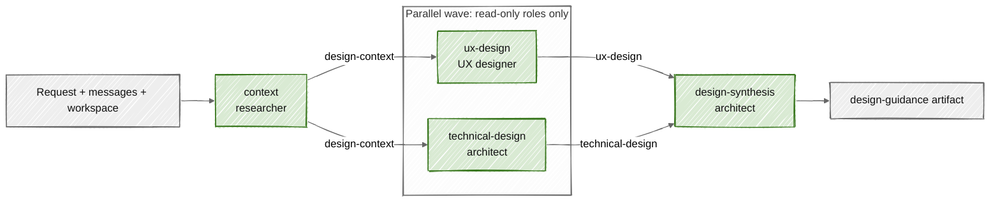
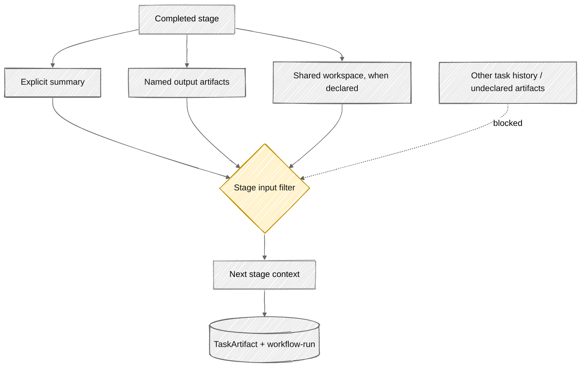

# Workflow orchestration

**Status:** Current executable workflow design and known limits.

## Control model

Complex workflows are declarative, versioned controller input. A model performs one assigned stage; it does not select the next role, invent dependencies, broaden artifact access, or decide when the workflow is complete.

Workflow YAML defines phases for user-visible progress and stages for execution. Each stage has one responsible agent, a responsibility, declared inputs and outputs, optional dependencies, and optional handoff content.

This sketch reflects [workflows/design.yaml](../../workflows/design.yaml).

## Definition contract

An executable workflow contains:

- `name`, `version`, description, and lifecycle `status`;
- UI phase mappings with task status and progress;
- orchestration mode: `sequential` or `dag`;
- `max_parallel` for dependency-ready stages;
- stage ID, responsible local agent DID, and responsibility;
- declared `inputs`, `outputs`, and DAG `depends_on` edges;
- optional handoff projection such as summary, artifacts, and workspace.

Tasks capture the workflow definition as a durable artifact. A retry uses that snapshot instead of silently adopting later registry edits. The accepted contract is [ADR 0003](../adr/0003-executable-multi-agent-workflows.md).

## Validation before useful work

Registry validation and orchestration enforce:

- exactly one responsible agent per stage;
- active workflow and promoted assigned agents at task creation;
- unique stage IDs and output names;
- known dependencies with no self-dependency or cycle;
- artifact inputs produced by valid sequential predecessors or DAG ancestors;
- a positive parallelism limit;
- no concurrent wave containing a write-capable agent.

The scheduler in [workflow_orchestration.py](../../apps/api/app/workflow_orchestration.py) computes dependency waves. A sequential workflow becomes one stage per wave. A DAG repeatedly selects stages whose dependencies are complete, then chunks them by `max_parallel`. No ready stage means the graph is cyclic or unresolved and execution fails.

## Parallelism rule

Parallel stages are permitted only when every assigned agent lacks write capabilities. The current write set includes repository mutation, dependency installation, commit, push, and production deployment.

This is intentionally conservative. Read-only models may inspect the same workspace concurrently. Writers remain serialized because the current workspace is shared and Autodev does not yet provide stage branches, transactional filesystem locks, or deterministic merge/conflict handling.

## Stage execution

For each stage, the controller:

1. verifies the assigned agent identity against its current declaration;
2. filters durable artifacts to the stage's declared inputs;
3. records a stage-start event with workflow, stage, agent ID, and DID;
4. creates an ephemeral role-specific sandbox unless the role is the task's primary agent;
5. invokes `AgentRuntime` with responsibility, input artifacts, expected outputs, handoff policy, steering, and session context;
6. records stage-attributed model and tool events;
7. always destroys the non-primary sandbox;
8. saves each named output and updates the durable `workflow-run` artifact.

Parallel stage callbacks share a persistence lock. This serializes SQL session writes and ordered event history even while model calls run concurrently.

## Artifact handoff

An output currently stores workflow ID, stage ID, agent ID, and the stage summary. The contract names the artifact even when its payload is prose. Downstream stages receive only requested named artifacts through `stage_artifact_inputs`; undeclared task artifacts do not enter their stage context.

This restriction reduces context cost, accidental coupling, and prompt-injection propagation. Workflow authors should treat output names and payload shapes as APIs and version the workflow when changing them.

## Durable run state

The `workflow-run` artifact records workflow ID/version, overall status, and per-stage status, wave, agent, inputs, outputs, summary, and handoff projection. Named outputs are separate task artifacts. Stage events remain attributable to workflow, stage, and agent.

If a stage raises an error, the controller marks that stage and the workflow run failed, preserves completed artifacts/evidence, and lets the outer task failure path checkpoint the workspace and clean up. Later waves do not start.

## Designing detailed workflows

Use these rules for a workflow that remains understandable under failure:

1. Give each stage one outcome that can be reviewed independently.
2. Use stable artifact names such as `story-context` or `verification-report`.
3. Put acceptance criteria in the producing stage's responsibility and consuming stage's inputs.
4. Parallelize independent analysis, never shared mutation.
5. Add a synthesis stage after parallel expert work rather than asking downstream users to reconcile conflicts.
6. Keep publication, deployment, and approvals as deterministic controller steps.
7. Prefer several bounded workflows over one graph with many conditional branches.
8. Version any change to role authority, graph topology, artifact contract, or harness dependency.

The active examples are [ideation](../../workflows/ideation.yaml), [design](../../workflows/design.yaml), [planning](../../workflows/planning.yaml), and [implementation](../../workflows/implementation.yaml).

## Current limits

- The legacy `sdlc` workflow still uses the original single-agent path.
- A stage has no independent queue, retry budget, approval lifecycle, or compensation transaction.
- Stage output payloads are not yet validated against declared JSON schemas.
- Conditional branches, loops, fan-in reducers, and dynamic graph mutation are not supported.
- A failed workflow retries at task/job level and depends on durable artifacts/workspace state; it does not resume from a formal per-stage checkpoint.
- Remote/A2A stages are not implemented.

These limits keep orchestration deterministic while the artifact and execution contracts mature.
